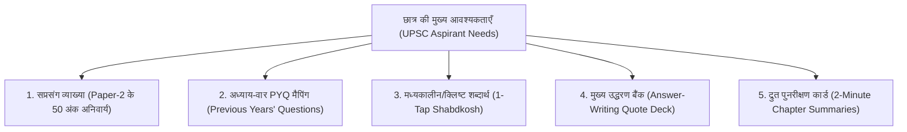

# हर्फ़ (Harf) — यूपीएससी व राज्य पीसीएस (हिन्दी साहित्य) मुद्रीकरण व उत्पाद योजना

> **प्रस्तावित नाम:** हर्फ़ अध्ययन (Harf Study) / हर्फ़ यूपीएससी साहित्य मित्र  
> **लक्षित वर्ग:** UPSC CSE (Civil Services Examination), UPPSC, BPSC, MPPSC, RPSC तथा UGC-NET/JRF (हिन्दी साहित्य वैकल्पिक विषय के अभ्यर्थी)।  
> **दस्तावेज़ स्थिति:** कार्ययोजना (Planning Document for Future Implementation)

---

## 1. बाज़ार विश्लेषण व अवसर (Market Opportunity)

1. **विशाल व समर्पित पाठक वर्ग:** 
   - यूपीएससी मेन्स में प्रतिवर्ष 10,000+ उम्मीदवार हिन्दी साहित्य वैकल्पिक विषय चुनते हैं। हिन्दी माध्यम के **65% से अधिक सफल अभ्यर्थी** इसी विषय से आते हैं।
   - UPPSC, BPSC और MPPSC जैसे राज्य सेवा आयोगों में 50,000+ छात्र हिन्दी साहित्य से मुख्य परीक्षा देते हैं।
   - UGC-NET/JRF हिन्दी में प्रति सत्र 1,00,000+ अभ्यर्थी बैठते हैं।
2. **उच्च भुगतान तत्परता (Willingness to Pay):**
   - दिल्ली (मुखर्जी नगर, दृष्टि आईएएस, करोल बाग) में केवल प्रिंटेड क्लासरूम नोट्स ₹3,000 से ₹5,000 में बिकते हैं।
   - छात्र प्रामाणिक पाठ्य-आधारित डिजिटल व्याख्या और उत्तर-लेखन सामग्री के लिए ₹499–₹1,499 खुशी-खुशी खर्च करते हैं।
3. **हर्फ़ की प्रतिस्पर्धी बढ़त (Harf's Edge):**
   - बाजार में केवल भारी-भरकम गाइड्स या अनफॉर्मेटेड PDFs मिलती हैं।
   - हर्फ़ के पास पहले से 100% ऑफ़लाइन, सुरुचिपूर्ण, विज्ञापन-मुक्त PWA ई-रीडर और 134 प्रामाणिक क्लासिक्स का विशाल भंडार है।

---

## 2. छात्रों की 5 बुनियादी ज़रूरतें (Aspirant Pain Points)

1. **सप्रसंग व्याख्या (Compulsory Contextual Explanations - 50 Marks):**
   - पेपर-2 में पद्य और गद्य दोनों खंडों में पहला प्रश्न अनिवार्य सप्रसंग व्याख्या का होता है।
   - छात्र को प्रसंग (Context), व्याख्या (Explanation), और विशेष (Literary/Philosophical significance) लिखना होता है।
2. **पिछले वर्षों के प्रश्न (PYQ Mapping):**
   - अध्याय पढ़ते समय तुरंत पता होना चाहिए कि 2013–2024 के बीच इस विशिष्ट प्रसंग या संवाद से क्या प्रश्न पूछे गए थे।
3. **अवधी, ब्रज व सधुक्कड़ी का शब्दार्थ:**
   - *पदमावत*, *भ्रमरगीत-सार*, *बिहारी सतसई*, *कबीर* और *चिन्तामणि* पढ़ते समय हर पंक्ति के क्लिष्ट शब्दों का एक-क्लिक संदर्भ अर्थ।
4. **उत्तर-लेखन उद्धरण (Quote Deck for High Scoring Answers):**
   - 15 में से 11+ अंक पाने के लिए उत्तर में मूल पाठ के सटीक संवाद और दोहे उद्धृत करने होते हैं।
5. **अध्याय सार व रिवीज़न नोट्स:**
   - मेन्स परीक्षा से 2 दिन पहले त्वरित पुनरीक्षण हेतु 2 मिनट का बुलेट-पॉइंट टेकअवे।

---

## 3. उत्पाद डिज़ाइन (Product UX / UI Architecture)

ई-रीडर टूलबार में एक न्यूनतम, सुरुचिपूर्ण टॉगल होगा:
> **[ 📖 सामान्य पठन (Reader Mode) | 🎓 अध्ययन मोड (UPSC Study Mode) ]**

### जब 'अध्ययन मोड' सक्रिय हो:
- **हाइलाइटेड की-पैराग्राफ़:** परीक्षा-दृष्टि से महत्वपूर्ण पंक्तियों और संवादों पर हल्की सुनहरी अंडरलाइन/बॉर्डर।
- **इंटरैक्टिव साइडशीट (Interactive Drawer):**
  - **📝 सप्रसंग व्याख्या:** प्रसंग, भावार्थ और 'विशेष' टिप्पणी।
  - **🎯 पूछे गए प्रश्न (PYQs):** वर्ष, प्रश्न और मॉडल उत्तर का ढांचा।
  - **💡 मुख्य बिंदु:** दर्शन, शिल्प, प्रतीक, और आधुनिक प्रासंगिकता।
- **शब्दार्थ पॉपओवर:** किसी भी कठिन शब्द पर क्लिक करते ही अर्थ प्रदर्शित।
- **कोट बैंक एक्सपोर्ट:** एक क्लिक में अपने 'नोटबुक' में मुख्य उद्धरण सहेजना।

---

## 4. मुद्रीकरण मॉडल (Monetization & Pricing Tiers)

| उत्पाद टीयर | शामिल सुविधाएँ | प्रस्तावित मूल्य |
| :--- | :--- | :--- |
| **सिंगल बुक स्टडी पैक** | किसी एक पुस्तक (उदा. *गोदान* या *कामायनी*) की संपूर्ण व्याख्या, PYQ और नोट्स | **₹99 – ₹149** (एकमुश्त) |
| **मध्यकालीन काव्य बंडल** | कबीर, सूरदास, तुलसीदास, जायसी, बिहारी का संपूर्ण व्याख्या व शब्दार्थ पैक | **₹399** |
| **UPSC ऑल-एक्सेस वार्षिक पास** | पाठ्यक्रम की सभी पुस्तकों का संपूर्ण स्टडी लेयर, मॉडल आंसर्स और नियमित अपडेट | **₹999 / वर्ष** |

### वित्तीय अनुमान (Year 1):
$$\text{2,500 ग्राहक} \times ₹999 = \mathbf{₹24,97,500} \text{ (~₹25 लाख)}$$
- 100% डिजिटल, शून्य लॉजिस्टिक्स/वेयरहाउसिंग लागत, हर्फ़ के मौजूदा PWA पर सीधे संचालित।

---

## 5. यूपीएससी पाठ्यक्रम पुस्तकों की कॉपीराइट व संग्रह स्थिति (Syllabus Audit)

### क. जो पुस्तकें हर्फ़ में पहले से उपलब्ध हैं (Already in Harf) ✅
1. **मुंशी प्रेमचंद**: *गोदान* (उपन्यास)
2. **मुंशी प्रेमचंद**: सर्वश्रेष्ठ कहानियाँ (*कफ़न*, *ईदगाह*, *पंच परमेश्वर*, *पूस की रात*, *बड़े घर की बेटी*, आदि)
3. **भारतेन्दु हरिश्चंद्र**: *भारत दुर्दशा* (नाटक) तथा *अंधेर नगरी* (राज्य पीसीएस)
4. **जयशंकर प्रसाद**: *स्कंदगुप्त* (नाटक) तथा *चन्द्रगुप्त*, *ध्रुवस्वामिनी* (राज्य पीसीएस)
5. **आचार्य रामचंद्र शुक्ल**: *चिन्तामणि* (भाग 1 - *कविता क्या है*, *श्रद्धा और भक्ति*, *उत्साह*, *लोभ और प्रीति*)
6. **आचार्य रामचंद्र शुक्ल**: *हिंदी साहित्य का इतिहास* (व्याकरण व इतिहास खंड)
7. **कबीर**: *कबीर ग्रंथावली* (संपा. श्यामसुंदर दास)
8. **सूरदास**: *भ्रमरगीत-सार* (संपा. आचार्य रामचंद्र शुक्ल)
9. **तुलसीदास**: *कवितावली* (उत्तरकाण्ड)
10. **मलिक मोहम्मद जायसी**: *पदमावत* (सिंहलद्वीप खंड व नागमती वियोग खंड)
11. **बिहारी**: *बिहारी सतसई* (संपा. जगन्नाथदास 'रत्नाकर')
12. **जयशंकर प्रसाद**: *कामायनी* (चिंता व श्रद्धा सर्ग)
13. **अयोध्यासिंह उपाध्याय 'हरिऔध'**: *प्रियप्रवास* (राज्य पीसीएस / नेट)
14. **लाला श्रीनिवास दास**: *परीक्षा गुरु* (राज्य पीसीएस / नेट)

---

### ख. जो हर्फ़ में नहीं हैं, लेकिन सार्वजनिक डोमेन (Public Domain) में हैं 🚀 (तत्काल जोड़ने योग्य)
*भारतीय कॉपीराइट अधिनियम 1957 (धारा 22) के अनुसार: लेखक के निधन के वर्ष से 60 वर्ष बाद (अर्थात 31 दिसंबर 1965 से पूर्व दिवंगत लेखक 2026 में 100% सार्वजनिक डोमेन में हैं)।*

1. **मैथिलीशरण गुप्त** (निधन: 12 दिसंबर 1964 ➔ 1 जनवरी 2025 से सार्वजनिक डोमेन):
   - 📌 **भारत-भारती** (UPSC अनिवार्य)
   - 📌 **साकेत** (नवम सर्ग) (UPPSC / BPSC / UGC-NET अनिवार्य)
2. **सूर्यकांत त्रिपाठी 'निराला'** (निधन: 15 अक्टूबर 1961 ➔ 1 जनवरी 2022 से सार्वजनिक डोमेन):
   - 📌 **राम की शक्तिपूजा** (UPSC अनिवार्य)
   - 📌 **कुकुरमुत्ता** (UPSC अनिवार्य)
   - 📌 **सरोज-स्मृति** (UPSC / NET अनिवार्य)
3. **गजानन माधव मुक्तिबोध** (निधन: 11 सितंबर 1964 ➔ 1 जनवरी 2025 से सार्वजनिक डोमेन):
   - 📌 **ब्रह्मराक्षस** (UPSC अनिवार्य)
   - 📌 **अंधेरे में** / **भूल-गलती** (UPSC अनिवार्य)
4. **गोस्वामी तुलसीदास** (17वीं शताब्दी ➔ सार्वजनिक डोमेन):
   - 📌 **रामचरितमानस (केवल सुन्दरकाण्ड)** (UPSC अनिवार्य)

> **अवसर:** केवल इन **4 लेखकों की 6–7 रचनाओं** को जोड़ते ही यूपीएससी पाठ्यक्रम का संपूर्ण सार्वजनिक डोमेन खंड हर्फ़ पर 100% पूर्ण हो जाएगा!

---

### ग. जो कॉपीराइट के अधीन हैं (NOT in Public Domain - अभी नहीं जोड़ सकते) ⚠️
*इनके रचनाकारों का निधन 1965 के बाद हुआ है, अतः ये 60-वर्षीय कॉपीराइट संरक्षण में हैं:*
1. **मोहन राकेश** (निधन: 1972) — *आषाढ़ का एक दिन* (2033 तक संरक्षित)
2. **रामधारी सिंह 'दिनकर'** (निधन: 1974) — *कुरुक्षेत्र* (2035 तक संरक्षित)
3. **यशपाल** (निधन: 1976) — *दिव्या* (2037 तक संरक्षित)
4. **फणीश्वरनाथ 'रेणु'** (निधन: 1977) — *मैला आंचल* (2038 तक संरक्षित)
5. **आचार्य हजारी प्रसाद द्विवेदी** (निधन: 1979) — *कुटज*, *अशोक के फूल*, *बाणभट्ट की आत्मकथा* (2040 तक संरक्षित)
6. **सच्चिदानंद हीरानंद वात्स्यायन 'अज्ञेय'** (निधन: 1987) — *असाध्य वीणा*, *आंगन के पार द्वार* (2048 तक संरक्षित)
7. **नागार्जुन** (निधन: 1998) — *बादल को घिरते देखा है*, *अकाल और उसके बाद*, *हरिजन गाथा* (2059 तक संरक्षित)
8. **मन्नू भंडारी** (निधन: 2021) — *महाभोज* (2082 तक संरक्षित)
9. **राजेंद्र यादव संकलित** — *एक दुनिया समानांतर* (समकालीन नई कहानियाँ)

*(नोट: इनके लिए भविष्य में प्रकाशकों—जैसे राजकमल, वाणी, लोकभारती—के साथ रॉयल्टी-शेयरिंग पार्टनरशिप की जा सकती है)।*

---

## 6. कार्यान्वयन चेकलिस्ट (Future Action Items)

- [ ] चरण 1: सार्वजनिक डोमेन की 4 शेष कृतियों (*भारत-भारती*, *साकेत नवम सर्ग*, *राम की शक्तिपूजा/कुकुरमुत्ता*, *रामचरितमानस सुन्दरकाण्ड*) को हर्फ़ में इंजेस्ट करना।
- [ ] चरण 2: `ReaderView.tsx` में 'अध्ययन मोड' (Study Mode) का यूआई स्विच बनाना।
- [ ] चरण 3: गोदान और कामायनी के लिए पहला पायलट स्टडी-पैक (व्याख्या + PYQ) तैयार करना।
- [ ] चरण 4: Razorpay / Stripe पेमेंट गेटवे का एकीकरण।
